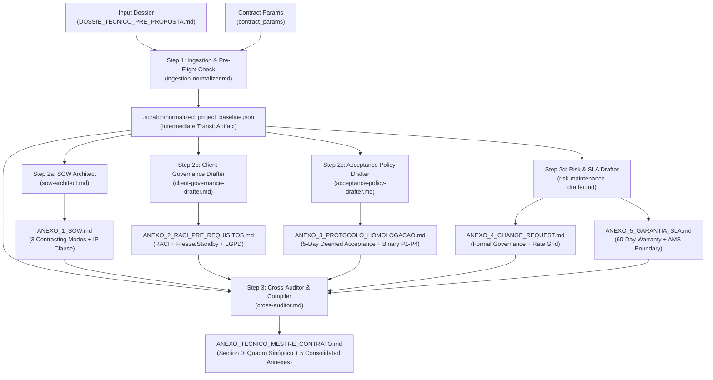

<div align="center">

<a href="https://www.halcyontech.com.br/" target="_blank" rel="noopener noreferrer">
  
</a>

# Contract Technical Annexes Engine Plugin Plugin
### Enterprise Multi-Agent Pipeline for Contract Technical Annexes Generation

[](https://antigravity.google)
[](./LICENSE)
[](https://www.halcyontech.com.br/)
[](https://github.com/HalcyonTech-LTDA)

<p align="center">
  <b>Pipeline agêntico nativo para geração de anexos técnicos vinculantes (SOW, RACI, Homologação, CR e SLA) para contratos de prestação de serviços de software a partir de dossiês de pré-venda.</b>
</p>

</div>

---

## Installation & Verification

### Antigravity CLI (`agy`)

Install directly into your Antigravity environment via the CLI:

```bash
agy plugin install https://github.com/HalcyonTech-LTDA/contract-technical-annexes-engine-plugin
```

Verify that the plugin is active and adheres to the strict official schema:

```bash
agy plugin list
agy plugin validate --strict ./contract-technical-annexes-engine-plugin
```

---

## 1. Overview & Strategic Mission

The **Contract Technical Annexes Engine Plugin** (`contract-technical-annexes-engine`, v1.2.0) is an enterprise-grade agentic customization for Google Antigravity. It bridges the high-risk operational boundary between pre-sales engineering and formal legal execution in custom software development.

By ingesting the consolidated pre-sales engineering dossier (`DOSSIE_TECNICO_PRE_PROPOSTA.md`) produced by upstream discovery engines, this plugin orchestrates a specialized multi-agent pipeline governed by a native **Skill Orchestrator** (`skills/contract-annexes-orchestrator/SKILL.md`) with cross-consistency auditing. It automatically drafts the complete set of **5 Binding Technical Contract Annexes (Bloco 1)** and a unified Master Document:

1. **ANEXO 1 — Statement of Work (SOW) & Escopo Técnico:** Rigorous noun-based scope formulation with verifiable criteria, mandatory exclusions (including native mobile apps and gateway transaction fees), **structural conditioning premises** (API latency < 500ms, sandbox stability, Swagger documentation), **support for 3 contracting models** (Fixed Price Milestones, Dedicated Squad / T&M, or Paid Phase 0 Inception), and **Intellectual Property boundaries (Foreground IP conditional upon 100% settlement vs. Background IP contractor reservation)**.
2. **ANEXO 2 — RACI Matrix & Client Pre-requisites:** Explicit bilateral 7-event RACI matrix, **Gate Zero / Marco Zero condition precedent (Termo de Liberação Integral de Acessos)**, qualified Client Response SLA of **up to 2 business days of commercial hours (16 business hours)** triggering day-for-day Schedule Freeze, **squad desmobilization / 5-day remobilization / standby fee protocols**, and **LGPD data protection in non-production environments (Client as Controller, Contractor as Processor, express ban on production PII dumps)**.
3. **ANEXO 3 — Acceptance & Homologation Protocol:** Elimination of subjective acceptance, irrevocable 5-day Tacit Acceptance (*Deemed Acceptance*) rule in Staging, **2-day retest window** strictly confined to the corrected defect, **exclusive bug consolidation by the Product Owner**, expanded 5-point technical evidence (including OS, browser and resolution), binary defect triage (P1/P2 blocker vs P3/P4 non-blocker), and **non-suspension of acceptance due to client-side legacy API/sandbox downtime**.
4. **ANEXO 4 — Change Request (CR) Protocol:** Immutable baseline governance with **3 formal Change Triggers**, **Scope Continuity Principle** during tramitation, 3-day client decision window with 10-day estimate validity, standard CR form with disciplina-based hour grids and electronic signatures, nullification of informal Slack/WhatsApp commands, and milestone recalibration formulas.
5. **ANEXO 5 — Technical Warranty & SLA Term:** 30–90 day latent defect warranty **triggered by the earlier of Definitive Acceptance or Go-Live**, explicit exclusions of 3rd-party API disruptions, operational errors by client users, and direct database tampering, 09:00–18:00 business days official support, 40 business hours P3 resolution SLA, and strict demarcation from ongoing Application Management Services (AMS).
6. **ANEXO_TECNICO_MESTRE_CONTRATO.md:** Master unified document starting with **Section 0: Quadro Sinóptico de Variáveis Contratuais (Mirror for the Main Contract)** followed by all 5 consolidated annexes, formatted for direct integration into digital signature platforms.

---

---

## 2. Critical Negative Constraints: Zero Slides & Zero Vagueness

> [!CAUTION]
> **STRICT NEGATIVE CONSTRAINTS**  
> 1. **Zero Slides Tolerance:** This plugin and all constituent agents are **strictly prohibited** from generating PowerPoint/Keynote slide decks, summary bullet presentations, or pitch outlines. All outputs must be formal, auditable Markdown artifacts (`.md`).
> 2. **Anti-Vagueness Invariant:** Scope definitions must never use open-ended verbs (e.g., "develop screens", "optimize engine", "test features"). Every scope item must be a verified substantive noun accompanied by testable acceptance criteria.
> 3. **Anti-Generalization Invariant:** Minutas must avoid vague legalese that obscures technical reality. Every technical dependency, API threshold, and defect class must be explicit.

---

---

## 4. Multi-Agent Pipeline Architecture (Native Skill DAG)

In native Antigravity architecture, execution graph intelligence resides within `skills/contract-annexes-orchestrator/SKILL.md`. The orchestrator model evaluates dependencies, executes pre-flight checks, handles template injection, invokes subagents with parallel fan-out, and performs fan-in cross-auditing:



---

---

## 5. Engineering Standards & Legal Shields (v1.2.0)

### 5.1 Dynamic Support for 3 Contracting Models in SOW
The Statement of Work (SOW) dynamically renders Section 4 according to the commercial model:
- **Modo A — Escopo Fechado (Fixed Price por Milestones):** Milestones (M0, M1, M2...) tied to physical staging deliverables and billing percentages.
- **Modo B — Squad Dedicada / Time & Materials:** Allocated technical capacity grid (seniority, hours/month, sprint cadence, recurring monthly capacity billing).
- **Modo C — Fase 0 (Inception Técnica Paga):** High-velocity architecture inception, clickable UX prototype, API integration spike, and refined MVP backlog.

### 5.2 Foreground IP vs. Background IP
- **Foreground IP (Suspensive Condition):** Assignment of proprietary rights over code specifically developed for the client is strictly conditioned on **100% full financial settlement** of all contract amounts and Change Requests.
- **Background IP (Contractor Retention):** Pre-existing internal libraries, infrastructure modules (IaC), templates, frameworks, and boilerplates remain the exclusive property of the contractor, granting the client a perpetual, non-exclusive, non-transferable embedded license.

### 5.3 LGPD Compliance in Engineering Environments
- **Role Definition:** The Client is the **Controlador** (Data Controller) and the Contractor is strictly the technical **Operadora** (Data Processor).
- **Production Data Ban:** Expressly bars the client from transmitting unanonymized production database dumps or real personal data (PII) to Development, QA, or Staging environments.

### 5.4 Pre-Flight Check with Smart Fallbacks
- **Strict Block (`STATUS: BLOCKED_MISSING_PRECONDITIONS`):** Only triggered if fundamental structural functional scope or core architectural stack is absent.
- **Non-Blocking Smart Fallbacks:** If secondary contract parameters are missing from pre-sales notes, the engine injects production-tested software house defaults and tracks them under `applied_defaults`:
  - Staging Homologation Window: `5 business days`
  - Client Response SLA (Freeze Trigger): `up to 2 business days of commercial hours (16 business hours)`
  - Technical Warranty: `60 calendar days from Definitive Acceptance or Go-Live (whichever occurs first)`
  - Change Request Rate: `[R$ VALOR_HORA_TECNICA_A_DEFINIR]`
  - Client Product Owner: `[NOME_E_CARGO_DO_PO_A_DESIGNAR]`

### 5.5 Section 0: Quadro Sinóptico de Variáveis Contratuais
`ANEXO_TECNICO_MESTRE_CONTRATO.md` starts with an executive synoptic table consolidating all legal-commercial variables (Parties, Contracting Mode, Schedule, Billing Milestones, CR Rate, Squad Standby Fee, UAT Window, Freeze SLA, Warranty, and Applied Defaults requiring legal ratification).

### 5.6 Core Battle-Tested Safeguards & Output Hygiene
- **Gate Zero / Marco Zero:** Development schedule day-count strictly commences only upon bilateral signing of the "Termo de Liberação Integral de Acessos e Ambientes".
- **Schedule Freeze & Standby Fee:** Delays > 2 business days of commercial hours (16 business hours) freeze schedules 1:1. Delays > 10 business days authorize squad reallocation (5 business days remobilization window). Forced readiness is billed as a **Squad Standby Fee** (the proportional hourly/daily cost of professionals kept on standby).
- **Tacit Acceptance & 2-Day Retest Window:** Client silence for 5 business days triggers irrevocable approval and payment release (applies to Milestones in Modo A, Sprints in Modo B, and Inception deliverables in Modo C). Verified bug fixes are subject to a strict 2-day retest window confined exclusively to the corrected defect, without reopening previously approved flows.
- **Mandatory Defect Evidence & PO Exclusivity:** Reported defects must be consolidated and submitted exclusively by the Product Owner and include the 5 mandatory technical evidence points: exact URL/endpoint, payload, deterministic reproduction steps, console/network logs, and tested browser, OS, and device/resolution (`{{REQUISITOS_EVIDENCIA_REPORTE_TECNICO}}`).
- **Resilience to Client Legacy Outages:** Downtime of client legacy ERPs/sandboxes does **not** pause the 5-day acceptance clock. Contractor conformity is proven via CI/CD automated test suites and mocks.
- **Change Request Governance & Scope Continuity:** Strict ban on informal requests (WhatsApp/Slack). Formal CRs require client decision in up to 3 business days (10 calendar days estimate validity), while engineering work strictly continues on original SOW scope.
- **Dual Warranty Trigger & Support SLA:** Latent defect warranty begins on the earlier of Definitive Acceptance or Go-Live, supported business days 09:00–18:00 with a 40 business hours P3 resolution SLA.
- **Strict Output Hygiene:** All template HTML comments (`<!-- ... -->`) are stripped, and all placeholders (`{{...}}`) must be fully rendered with substantive legal-engineering text.

---

---

## What's Included (Component Catalog)

### Contextual Rules (`rules/`)
Automatically loaded to govern and protect project contexts:
- **[`contract-engineering-standards.md`](rules/contract-engineering-standards.md)**: Aplicar exclusivamente durante a elaboração, revisão ou auditoria de anexos técnicos contratuais de software (SOW, RACI, Homologação, Change Request, Garantia e SLA).
- **[`legal-technical-boundaries.md`](rules/legal-technical-boundaries.md)**: Aplicar exclusivamente durante a elaboração, revisão ou auditoria de anexos técnicos contratuais de software (SOW, RACI, Homologação, Change Request, Garantia e SLA).

### Procedural Skills (`skills/`)
On-demand actionable workflows and runbooks:
- **[`/contract-annexes-orchestrator`](skills/contract-annexes-orchestrator/SKILL.md)**: Orquestra a esteira agêntica (DAG) de engenharia para transformar o dossiê técnico de pré-venda (DOSSIE_TECNICO_PRE_PROPOSTA.md) nos 5 anexos técnicos vinculantes (SOW, RACI, Homologação, CR e SLA) e no Documento Mestre Unificado (ANEXO_TECNICO_MESTRE_CONTRATO.md).

### Specialized Subagents (`agents/`)
Autonomous personas delegated for in-depth execution:
- **[`acceptance-policy-drafter`](agents/acceptance-policy-drafter.md)**: Redige o Anexo 3 (Protocolo de Homologação e Critérios de Aceite), definindo ambiente de Staging, janela de testes, taxonomia P1-P4, cláusula pétrea de aceite tácito e presunção de conformidade.
- **[`client-governance-drafter`](agents/client-governance-drafter.md)**: Redige o Anexo 2 (Matriz RACI e Pré-requisitos), detalhando a matriz bilateral de engenharia, Gate Zero, delimitação do Product Owner, conformidade LGPD (Controlador vs Operador) e cláusula de Schedule Freeze.
- **[`cross-auditor`](agents/cross-auditor.md)**: Executa a auditoria cruzada entre todos os 5 anexos gerados, elimina inconsistências e compila o Documento Mestre Unificado (ANEXO_TECNICO_MESTRE_CONTRATO.md).
- **[`ingestion-normalizer`](agents/ingestion-normalizer.md)**: Analisa o dossiê técnico de pré-venda, valida a completude das premissas e normaliza os dados de escopo, riscos, prazos e stack técnica, aplicando fallbacks inteligentes.
- **[`risk-maintenance-drafter`](agents/risk-maintenance-drafter.md)**: Redige os Anexos 4 (Gestão de Mudanças - CR) e 5 (Termo de Garantia, SLA e Sustentação), blindando contra escopo informal e suporte perpétuo gratuito.
- **[`sow-architect`](agents/sow-architect.md)**: Redige o Anexo 1 (Statement of Work), detalhando o escopo por entregáveis auditáveis, a lista taxativa de não-escopo, requisitos não-funcionais, modelo de contratação, premissas estruturais condicionantes e propriedade intelectual (Foreground vs Background IP).

---

## Directory Hierarchy

```text
contract-technical-annexes-engine-plugin/
├── plugin.json              # Official Antigravity manifest (schema v1)
├── LICENSE                  # MIT License (Copyright 2026 HalcyonTech LTDA)
├── .gitignore               # System ignores & installed_version.json exclusions
├── .gitattributes           # Deterministic line endings (* text=auto eol=lf)
├── README.md                # Golden Standard documentation & runbook
├── assets/
│   ├── logo.svg             # Antigravity marketplace square icon
│   └── halcyon-horizontal-cor.svg # Official Halcyon Tech brand logo (white background)             # Official Halcyon Tech corporate vector symbol
├── rules/                   # Contextual rules discovered automatically
│   └── contract-engineering-standards.md
│   └── legal-technical-boundaries.md
├── skills/                  # Actionable procedural skills (Progressive Disclosure)
│   └── contract-annexes-orchestrator/
│       └── SKILL.md
└── agents/                  # Specialized autonomous subagents
    └── acceptance-policy-drafter.md
    └── client-governance-drafter.md
    └── cross-auditor.md
    └── ingestion-normalizer.md
    └── risk-maintenance-drafter.md
    └── sow-architect.md
```

---

## 💡 Prompt Recipes & Use Cases

```markdown
- "Estruture os anexos técnicos contratuais (SOW, RACI, Homologação, CR e SLA)"
- "Audite as cláusulas e salvaguardas contratuais contra riscos de entrega"
- "Gere o documento consolidado ANEXO_TECNICO_MESTRE_CONTRATO.md"
```

---

## 📄 License & Corporate Governance

Distributed under the **MIT License**. Copyright (c) 2026 **HalcyonTech LTDA**.  
Engineered with precision and excellence by [Halcyon Tech](https://www.halcyontech.com.br/) &mdash; [GitHub Organization](https://github.com/HalcyonTech-LTDA).
