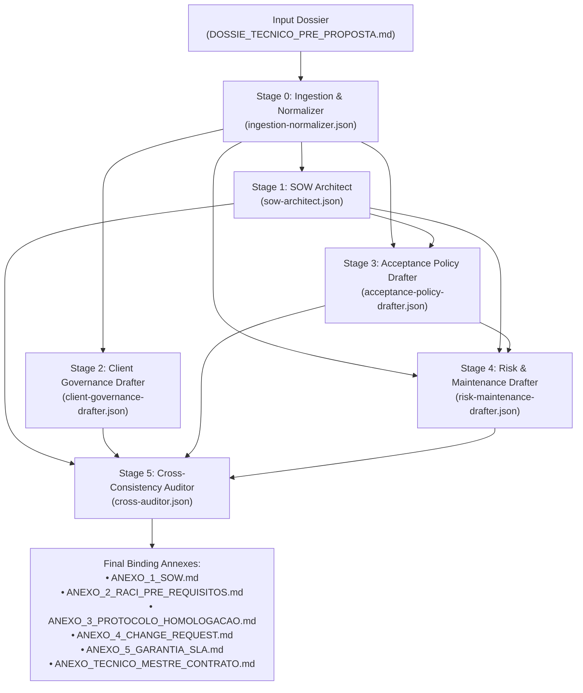

<div align="center">

# Contract Technical Annexes Engine Plugin
### Global Multi-Agent Engineering Pipeline for Binding Software Contract Technical Annexes

[](https://antigravity.google)
[](#multi-agent-dag-pipeline-architecture)
[](./LICENSE)
[](#critical-negative-constraints-zero-slides--zero-vagueness)

<p align="center">
  <b>Transform the pre-sales engineering dossier (<code>DOSSIE_TECNICO_PRE_PROPOSTA.md</code>) and contractual parameters into 5 binding, auditable technical annexes for enterprise software engineering service contracts.</b>
</p>

</div>

---

## 1. Overview & Strategic Mission

The **Contract Technical Annexes Engine Plugin** (`contract-technical-annexes-engine-plugin`) is an enterprise-grade agentic customization for Google Antigravity. It is engineered to bridge the high-risk operational boundary between pre-sales engineering and formal legal execution in custom software development.

By ingesting the consolidated pre-sales engineering dossier (`DOSSIE_TECNICO_PRE_PROPOSTA.md`) produced by upstream discovery engines, this plugin orchestrates a specialized multi-agent pipeline governed by a Directed Acyclic Graph (DAG) with cross-consistency auditing. It automatically drafts the complete set of **5 Binding Technical Contract Annexes (Bloco 1)**:

1. **ANEXO 1 — Statement of Work (SOW) & Escopo Técnico:** Rigorous noun-based scope formulation with verifiable criteria and mandatory exclusions.
2. **ANEXO 2 — RACI Matrix & Client Pre-requisites:** Explicit bilateral operational dependencies and automatic day-for-day Schedule Freeze protection against client blockers.
3. **ANEXO 3 — Acceptance & Homologation Protocol:** Elimination of subjective acceptance, an irrevocable 5-day Tacit Acceptance (*Deemed Acceptance*) rule in Staging, and binary defect triage (P1/P2 blocker vs P3/P4 non-blocker).
4. **ANEXO 4 — Change Request (CR) Protocol:** Immutable baseline governance with clear deviation workflows, cost-per-hour grids, and milestone recalibration formulas.
5. **ANEXO 5 — Technical Warranty & SLA Term:** 30–90 day latent defect warranty boundaries, explicit exclusions of 3rd-party API disruptions and client tampering, and strict demarcation from ongoing Application Management Services (AMS).

---

## 2. Critical Negative Constraints: Zero Slides & Zero Vagueness

> [!CAUTION]
> **STRICT NEGATIVE CONSTRAINTS**  
> 1. **Zero Slides Tolerance:** This plugin and all constituent agents are **strictly prohibited** from generating PowerPoint/Keynote slide decks, summary bullet presentations, or pitch outlines. All outputs must be formal, auditable Markdown artifacts (`.md`).
> 2. **Anti-Vagueness Invariant:** Scope definitions must never use open-ended verbs (e.g., "develop screens", "optimize engine", "test features"). Every scope item must be a verified substantive noun accompanied by testable acceptance criteria.
> 3. **Anti-Generalization Invariant:** Minutas must avoid vague legalese that obscures technical reality. Every technical dependency, API threshold, and defect class must be explicit.

---

## 3. Directory Structure

```
contract-technical-annexes-engine-plugin/
├── plugin.json
├── README.md
├── LICENSE
├── rules/
│   ├── contract-engineering-standards.md
│   └── legal-technical-boundaries.md
├── agents/
│   ├── ingestion-normalizer.json
│   ├── sow-architect.json
│   ├── client-governance-drafter.json
│   ├── acceptance-policy-drafter.json
│   ├── risk-maintenance-drafter.json
│   └── cross-auditor.json
├── workflows/
│   └── generate-annexes.dag.json
└── templates/
    ├── ANEXO_1_SOW.template.md
    ├── ANEXO_2_RACI_PRE_REQUISITOS.template.md
    ├── ANEXO_3_PROTOCOLO_HOMOLOGACAO.template.md
    ├── ANEXO_4_CHANGE_REQUEST.template.md
    └── ANEXO_5_GARANTIA_SLA.template.md
```

---

## 4. Multi-Agent DAG Pipeline Architecture

The plugin executes via a deterministic Directed Acyclic Graph (DAG) with dependency gating and cross-document validation:



---

## 5. Global Engineering & Legal Rules

### Rule 1: Substantivação do Escopo (Anti-Ambiguity)
- Scope descriptions cannot use vague, unmeasurable action verbs.
- Each deliverable must be formulated as an auditable technical noun (e.g., *"Responsive Web Interface for automated financial reconciliation with date filters, status toggles, and CSV streaming export"*).

### Rule 2: Obrigatoriedade Taxativa do "Não-Escopo" (Out of Scope)
The SOW must contain an explicit, non-negotiable list of contractual exclusions:
1. Migration, cleansing, or remediation of legacy customer databases.
2. Support for legacy browsers outside the 3 most recent versions of Google Chrome, Apple Safari, and Microsoft Edge.
3. Cloud hosting fees (AWS/GCP/Azure) or 3rd-party API license invoices (OpenAI, payment gateways, messaging APIs).
4. In-person onboarding or L1 technical end-user support.

### Rule 3: Inadmissibilidade de Aceite Subjetivo
- Subjective acceptance criteria (e.g., *"clean look and feel"*, *"modern intuitive UX"*) are legally and technically null and void.
- Homologation is strictly bound to verifiable acceptance criteria agreed upon in the milestone delivery sheets.

### Rule 4: Cláusula Pétrea de Aceite Tácito (Deemed Acceptance)
- The client receives a maximum window of **5 (five) business days** to conduct UAT in Staging.
- If no detailed technical defect report is submitted within 5 business days, the milestone is **irrevocably deemed accepted**, authorizing immediate billing and milestone schedule progression.

### Rule 5: Classificação Binária de Defeitos
- Only **P1 (Blocker)** and **P2 (Critical without workaround)** can withhold milestone sign-off and billing.
- **P3 (Major with workaround)** and **P4 (Cosmetic)** trigger milestone sign-off and payment release, with fixes scheduled for the next development sprint.

### Rule 6: Separação de Obrigações Bilaterais & Schedule Freeze
- Custom software engineering is an obligation of means requiring active client cooperation.
- Client-side delays (credentials, sandboxes, business rule decisions) trigger an automatic **Schedule Freeze** extending deadlines without liquidated damages or contractor penalties.

### Rule 7: Fronteira da Garantia vs. Sustentação (AMS)
- Technical warranty (30 to 90 days) covers strictly latent defects in code authored by the contractor.
- Third-party API changes, unauthorized client code modifications, and new business rules are categorically excluded. Any post-warranty intervention requires an autonomous AMS or Change Request agreement.

---

## 6. Available Commands & Workflow

To execute the technical annexes generation pipeline:

```bash
# Antigravity CLI / Assistant Command
contract:generate-annexes dossier_path="DOSSIE_TECNICO_PRE_PROPOSTA.md" output_dir="./anexos_contratuais"
```

### Arguments:
- `dossier_path` *(string, default: `DOSSIE_TECNICO_PRE_PROPOSTA.md`)*: Path to the pre-sales engineering dossier.
- `output_dir` *(string, default: `./anexos_contratuais`)*: Target folder where the 5 Markdown annexes and audit report are deposited.

---

## 7. License & Credits

- **Author:** Engineering Architecture Office / HalcyonTech-LTDA
- **Organization:** [HalcyonTech-LTDA](https://github.com/HalcyonTech-LTDA)
- **License:** [MIT](./LICENSE)
