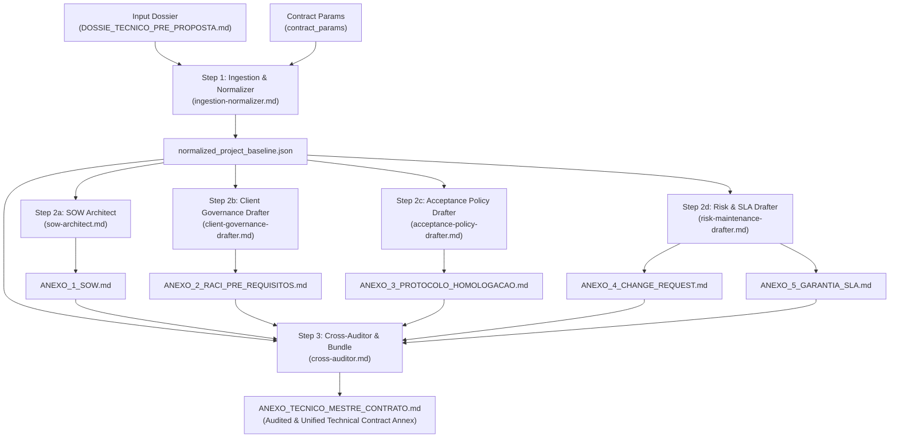

<div align="center">

# Contract Technical Annexes Engine Plugin
### Global Multi-Agent Engineering Pipeline for Binding Software Contract Technical Annexes

[](https://antigravity.google)
[](#4-multi-agent-dag-pipeline-architecture)
[](./LICENSE)
[](#2-critical-negative-constraints-zero-slides--zero-vagueness)

<p align="center">
  <b>Transform the pre-sales engineering dossier (<code>DOSSIE_TECNICO_PRE_PROPOSTA.md</code>) and contractual parameters into 5 binding, auditable technical annexes for enterprise software engineering service contracts.</b>
</p>

</div>

---

## 1. Overview & Strategic Mission

The **Contract Technical Annexes Engine Plugin** (`contract-technical-annexes-engine`) is an enterprise-grade agentic customization for Google Antigravity. It is engineered to bridge the high-risk operational boundary between pre-sales engineering and formal legal execution in custom software development.

By ingesting the consolidated pre-sales engineering dossier (`DOSSIE_TECNICO_PRE_PROPOSTA.md`) produced by upstream discovery engines, this plugin orchestrates a specialized multi-agent pipeline governed by a native **Skill Orchestrator** (`skills/contract-annexes-orchestrator/SKILL.md`) with cross-consistency auditing. It automatically drafts the complete set of **5 Binding Technical Contract Annexes (Bloco 1)**:

1. **ANEXO 1 — Statement of Work (SOW) & Escopo Técnico:** Rigorous noun-based scope formulation with verifiable criteria, mandatory exclusions, and **Intellectual Property (IP) reservation conditioned on 100% invoice settlement**.
2. **ANEXO 2 — RACI Matrix & Client Pre-requisites:** Explicit bilateral operational dependencies, day-for-day Schedule Freeze protection against client blockers, and **squad desmobilization / 5-day remobilization / standby fee protocols**.
3. **ANEXO 3 — Acceptance & Homologation Protocol:** Elimination of subjective acceptance, irrevocable 5-day Tacit Acceptance (*Deemed Acceptance*) rule in Staging, binary defect triage (P1/P2 blocker vs P3/P4 non-blocker), and **non-suspension of acceptance due to client-side legacy API/sandbox downtime**.
4. **ANEXO 4 — Change Request (CR) Protocol:** Immutable baseline governance with clear deviation workflows, cost-per-hour grids, nullification of informal Slack/WhatsApp commands, and milestone recalibration formulas.
5. **ANEXO 5 — Technical Warranty & SLA Term:** 30–90 day latent defect warranty boundaries, explicit exclusions of 3rd-party API disruptions and client tampering, and strict demarcation from ongoing Application Management Services (AMS).

---

## 2. Critical Negative Constraints: Zero Slides & Zero Vagueness

> [!CAUTION]
> **STRICT NEGATIVE CONSTRAINTS**  
> 1. **Zero Slides Tolerance:** This plugin and all constituent agents are **strictly prohibited** from generating PowerPoint/Keynote slide decks, summary bullet presentations, or pitch outlines. All outputs must be formal, auditable Markdown artifacts (`.md`).
> 2. **Anti-Vagueness Invariant:** Scope definitions must never use open-ended verbs (e.g., "develop screens", "optimize engine", "test features"). Every scope item must be a verified substantive noun accompanied by testable acceptance criteria.
> 3. **Anti-Generalization Invariant:** Minutas must avoid vague legalese that obscures technical reality. Every technical dependency, API threshold, and defect class must be explicit.

---

## 3. Directory Structure

```
contract-technical-annexes-engine/
├── plugin.json
├── README.md
├── LICENSE
├── .gitignore
├── rules/
│   ├── contract-engineering-standards.md
│   └── legal-technical-boundaries.md
├── skills/
│   └── contract-annexes-orchestrator/
│       └── SKILL.md
├── agents/
│   ├── ingestion-normalizer.md
│   ├── sow-architect.md
│   ├── client-governance-drafter.md
│   ├── acceptance-policy-drafter.md
│   ├── risk-maintenance-drafter.md
│   └── cross-auditor.md
└── templates/
    ├── ANEXO_1_SOW.template.md
    ├── ANEXO_2_RACI_PRE_REQUISITOS.template.md
    ├── ANEXO_3_PROTOCOLO_HOMOLOGACAO.template.md
    ├── ANEXO_4_CHANGE_REQUEST.template.md
    └── ANEXO_5_GARANTIA_SLA.template.md
```

---

## 4. Multi-Agent Pipeline Architecture (Native Skill DAG)

In native Antigravity architecture, the execution graph intelligence resides within `skills/contract-annexes-orchestrator/SKILL.md`. The orchestrator model reads the structured runbook, verifies preconditions, invokes subagents with parallel fan-out, and performs fan-in cross-auditing:



---

## 5. Global Engineering & Legal Rules

### Rule 1: Substantivação do Escopo (Anti-Ambiguity)
- Scope descriptions cannot use vague, unmeasurable action verbs.
- Each deliverable must be formulated as an auditable technical noun (e.g., *"Responsive Web Interface for automated financial reconciliation with date filters, status toggles, and CSV streaming export"*).

### Rule 2: Obrigatoriedade Taxativa do "Não-Escopo" (Out of Scope)
The SOW must contain an explicit, non-negotiable list of contractual exclusions:
1. Migration, cleansing, or remediation of legacy customer databases.
2. Support for legacy browsers outside the 3 most recent versions of Google Chrome, Apple Safari, and Microsoft Edge.
3. Cloud hosting fees (AWS/GCP/Azure) or 3rd-party API license invoices (OpenAI, payment gateways, messaging APIs).
4. In-person onboarding or L1 technical end-user support.

### Rule 3: Inadmissibilidade de Aceite Subjetivo
- Subjective acceptance criteria (e.g., *"clean look and feel"*, *"modern intuitive UX"*) are legally and technically null and void.
- Homologation is strictly bound to verifiable acceptance criteria agreed upon in the milestone delivery sheets.

### Rule 4: Cláusula Pétrea de Aceite Tácito (Deemed Acceptance)
- The client receives a maximum window of **5 (five) business days** to conduct UAT in Staging.
- If no detailed technical defect report is submitted within 5 business days, the milestone is **irrevocably deemed accepted**, authorizing immediate billing and milestone schedule progression.

### Rule 5: Classificação Binária de Defeitos
- Only **P1 (Blocker)** and **P2 (Critical without workaround)** can withhold milestone sign-off and billing.
- **P3 (Major with workaround)** and **P4 (Cosmetic)** trigger milestone sign-off and payment release, with fixes scheduled for the next development sprint.

### Rule 6: Não-Interrupção do Aceite Tácito por Instabilidade Legada do Cliente
- Downtime, latency, schema breaks, or network failures in legacy sandboxes, ERPs, or APIs under client custody do **NOT** pause or extend the 5-day Deemed Acceptance window.
- Contractor compliance is verified and approved autonomously via automated CI/CD test suites with mocks/stubs, releasing invoice billing for the milestone.

### Rule 7: Separação de Obrigações Bilaterais, Schedule Freeze e Protocolo de Standby/Remobilização
- Software development is an obligation of means requiring active client cooperation.
- Client-side delays (>48h business hours) trigger an automatic day-for-day **Schedule Freeze** without penalties or liquidated damages against the contractor.
- **Desmobilization & Remobilization:** If client delays exceed 10 business days, the contractor may reassign squad engineers to other productive work. Client resumption requires an up to **5 business day remobilization window** without mora. If the client demands exclusive standby during the freeze, an hourly/daily **Squad Standby Fee** is billed.

### Rule 8: Reserva de Propriedade Intelectual (IP) Vinculada à Quitação Integral
- Definitive transfer and assignment of intellectual property rights over source code, repositories, and technical deliverables are strictly conditioned upon **100% full financial settlement** of all project invoices and approved Change Requests.
- Until full settlement, the client holds strictly a temporary, non-exclusive, revocable license for Staging UAT; commercial exploitation, sublicensing, or production deployment is barred.

### Rule 9: Fronteira da Garantia vs. Sustentação (AMS)
- Technical warranty (30 to 90 days) covers strictly latent defects in code authored by the contractor.
- Third-party API changes, unauthorized client code modifications, and new business rules are categorically excluded. Any post-warranty intervention requires an autonomous AMS or Change Request agreement.

---

## 6. Guia de Instalação e Execução no Antigravity

### 6.1 Instalação Global

Copie toda a pasta do plugin para o diretório de plugins globais do Antigravity:

```bash
mkdir -p ~/.antigravity/plugins/contract-technical-annexes-engine
cp -r ./* ~/.antigravity/plugins/contract-technical-annexes-engine/
```

Ou, caso utilize a configuração global padrão do Antigravity / Gemini CLI:

```bash
mkdir -p ~/.gemini/config/plugins/contract-technical-annexes-engine-plugin
cp -r ./* ~/.gemini/config/plugins/contract-technical-annexes-engine-plugin/
```

### 6.2 Invocação Nativa via Slash Command

Com o plugin habilitado, execute diretamente na caixa de chat do Antigravity:

```bash
/contract-generate-annexes dossier_path="DOSSIE_TECNICO_PRE_PROPOSTA.md" output_dir="./anexos_contratuais"
```

Ou via invocação semântica contextual:
> *"Gere os anexos técnicos do contrato a partir do arquivo DOSSIE_TECNICO_PRE_PROPOSTA.md"*

### 6.3 Parâmetros de Execução

| Parâmetro | Tipo | Obrigatório | Padrão | Descrição |
| :--- | :---: | :---: | :--- | :--- |
| `dossier_path` | string | Sim | `DOSSIE_TECNICO_PRE_PROPOSTA.md` | Caminho para o dossiê técnico consolidado da pré-venda. |
| `output_dir` | string | Não | `./anexos_contratuais` | Diretório de destino dos artefatos Markdown gerados. |
| `contract_params` | object | Não | `{}` | Metadados jurídicos (Razão Social, CNPJs, taxas de CR, prazos de garantia). |

### 6.4 Artefatos Produzidos no Diretório de Destino

1. **`ANEXO_1_SOW.md`**: Declaração de Trabalho (SOW) com escopo discriminado em substantivos, matriz de não-escopo, NFRs, tabela de marcos vinculada ao faturamento e **reserva de IP até quitação de 100%**.
2. **`ANEXO_2_RACI_PRE_REQUISITOS.md`**: Matriz RACI, designação de PO único, Cláusula Pétrea de Schedule Freeze, **desmobilização após 10 dias de freeze, janela de 5 dias de remobilização e Taxa de Standby da squad**.
3. **`ANEXO_3_PROTOCOLO_HOMOLOGACAO.md`**: Procedimento formal de UAT em Staging, janela de 5 dias úteis com Aceite Tácito (*Deemed Acceptance*), taxonomia P1–P4 e **não-suspensão por instabilidade de APIs legadas do cliente**.
4. **`ANEXO_4_CHANGE_REQUEST.md`**: Protocolo de governança de mudanças nos 3 eixos (Horas, Caminho Crítico e Custo) com proibição de instruções informais via chat.
5. **`ANEXO_5_GARANTIA_SLA.md`**: Termo de Garantia Técnica (60 dias), tabela de SLA para incidentes (P1–P3) e transição para AMS.
6. **`ANEXO_TECNICO_MESTRE_CONTRATO.md`**: Documento unificado, auditado por consistência cruzada nos 6 eixos, pronto para rubrica e vinculação ao contrato principal.

---

## 7. License & Credits

- **Author:** Engineering Architecture Office / HalcyonTech-LTDA
- **Organization:** [HalcyonTech-LTDA](https://github.com/HalcyonTech-LTDA)
- **License:** [MIT](./LICENSE)
