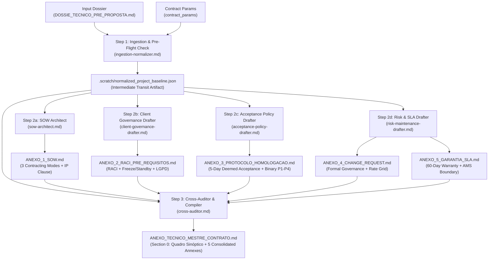

<div align="center">

# Contract Technical Annexes Engine Plugin
### Global Multi-Agent Engineering Pipeline for Binding Software Contract Technical Annexes

[](https://antigravity.google)
[](#4-multi-agent-dag-pipeline-architecture)
[](./LICENSE)
[](#2-critical-negative-constraints-zero-slides--zero-vagueness)

<p align="center">
  <b>Transform the pre-sales engineering dossier (<code>DOSSIE_TECNICO_PRE_PROPOSTA.md</code>) and contractual parameters into 5 binding, auditable technical annexes for enterprise software engineering service contracts.</b>
</p>

</div>

---

## 1. Overview & Strategic Mission

The **Contract Technical Annexes Engine Plugin** (`contract-technical-annexes-engine`, v1.2.0) is an enterprise-grade agentic customization for Google Antigravity. It bridges the high-risk operational boundary between pre-sales engineering and formal legal execution in custom software development.

By ingesting the consolidated pre-sales engineering dossier (`DOSSIE_TECNICO_PRE_PROPOSTA.md`) produced by upstream discovery engines, this plugin orchestrates a specialized multi-agent pipeline governed by a native **Skill Orchestrator** (`skills/contract-annexes-orchestrator/SKILL.md`) with cross-consistency auditing. It automatically drafts the complete set of **5 Binding Technical Contract Annexes (Bloco 1)** and a unified Master Document:

1. **ANEXO 1 — Statement of Work (SOW) & Escopo Técnico:** Rigorous noun-based scope formulation with verifiable criteria, mandatory exclusions (including native mobile apps and gateway transaction fees), **structural conditioning premises** (API latency < 500ms, sandbox stability, Swagger documentation), **support for 3 contracting models** (Fixed Price Milestones, Dedicated Squad / T&M, or Paid Phase 0 Inception), and **Intellectual Property boundaries (Foreground IP conditional upon 100% settlement vs. Background IP contractor reservation)**.
2. **ANEXO 2 — RACI Matrix & Client Pre-requisites:** Explicit bilateral 7-event RACI matrix, **Gate Zero / Marco Zero condition precedent (Termo de Liberação Integral de Acessos)**, qualified Client Response SLA of **up to 2 business days of commercial hours (16 business hours)** triggering day-for-day Schedule Freeze, **squad desmobilization / 5-day remobilization / standby fee protocols**, and **LGPD data protection in non-production environments (Client as Controller, Contractor as Processor, express ban on production PII dumps)**.
3. **ANEXO 3 — Acceptance & Homologation Protocol:** Elimination of subjective acceptance, irrevocable 5-day Tacit Acceptance (*Deemed Acceptance*) rule in Staging, **2-day retest window** strictly confined to the corrected defect, **exclusive bug consolidation by the Product Owner**, expanded 5-point technical evidence (including OS, browser and resolution), binary defect triage (P1/P2 blocker vs P3/P4 non-blocker), and **non-suspension of acceptance due to client-side legacy API/sandbox downtime**.
4. **ANEXO 4 — Change Request (CR) Protocol:** Immutable baseline governance with **3 formal Change Triggers**, **Scope Continuity Principle** during tramitation, 3-day client decision window with 10-day estimate validity, standard CR form with disciplina-based hour grids and electronic signatures, nullification of informal Slack/WhatsApp commands, and milestone recalibration formulas.
5. **ANEXO 5 — Technical Warranty & SLA Term:** 30–90 day latent defect warranty **triggered by the earlier of Definitive Acceptance or Go-Live**, explicit exclusions of 3rd-party API disruptions, operational errors by client users, and direct database tampering, 09:00–18:00 business days official support, 40 business hours P3 resolution SLA, and strict demarcation from ongoing Application Management Services (AMS).
6. **ANEXO_TECNICO_MESTRE_CONTRATO.md:** Master unified document starting with **Section 0: Quadro Sinóptico de Variáveis Contratuais (Mirror for the Main Contract)** followed by all 5 consolidated annexes, formatted for direct integration into digital signature platforms.

---

## 2. Critical Negative Constraints: Zero Slides & Zero Vagueness

> [!CAUTION]
> **STRICT NEGATIVE CONSTRAINTS**  
> 1. **Zero Slides Tolerance:** This plugin and all constituent agents are **strictly prohibited** from generating PowerPoint/Keynote slide decks, summary bullet presentations, or pitch outlines. All outputs must be formal, auditable Markdown artifacts (`.md`).
> 2. **Anti-Vagueness Invariant:** Scope definitions must never use open-ended verbs (e.g., "develop screens", "optimize engine", "test features"). Every scope item must be a verified substantive noun accompanied by testable acceptance criteria.
> 3. **Anti-Generalization Invariant:** Minutas must avoid vague legalese that obscures technical reality. Every technical dependency, API threshold, and defect class must be explicit.

---

## 3. Directory Structure (Antigravity v1.2.0 Compliant)

All contract templates are securely encapsulated inside the orchestrating skill folder for global, project-independent execution:

```
contract-technical-annexes-engine/
├── plugin.json
├── README.md
├── LICENSE
├── .gitignore
├── rules/
│   ├── contract-engineering-standards.md
│   └── legal-technical-boundaries.md
├── skills/
│   └── contract-annexes-orchestrator/
│       ├── SKILL.md
│       └── templates/
│           ├── ANEXO_1_SOW.template.md
│           ├── ANEXO_2_RACI_PRE_REQUISITOS.template.md
│           ├── ANEXO_3_PROTOCOLO_HOMOLOGACAO.template.md
│           ├── ANEXO_4_CHANGE_REQUEST.template.md
│           └── ANEXO_5_GARANTIA_SLA.template.md
└── agents/
    ├── ingestion-normalizer.md
    ├── sow-architect.md
    ├── client-governance-drafter.md
    ├── acceptance-policy-drafter.md
    ├── risk-maintenance-drafter.md
    └── cross-auditor.md
```

---

## 4. Multi-Agent Pipeline Architecture (Native Skill DAG)

In native Antigravity architecture, execution graph intelligence resides within `skills/contract-annexes-orchestrator/SKILL.md`. The orchestrator model evaluates dependencies, executes pre-flight checks, handles template injection, invokes subagents with parallel fan-out, and performs fan-in cross-auditing:



---

## 5. Engineering Standards & Legal Shields (v1.2.0)

### 5.1 Dynamic Support for 3 Contracting Models in SOW
The Statement of Work (SOW) dynamically renders Section 4 according to the commercial model:
- **Modo A — Escopo Fechado (Fixed Price por Milestones):** Milestones (M0, M1, M2...) tied to physical staging deliverables and billing percentages.
- **Modo B — Squad Dedicada / Time & Materials:** Allocated technical capacity grid (seniority, hours/month, sprint cadence, recurring monthly capacity billing).
- **Modo C — Fase 0 (Inception Técnica Paga):** High-velocity architecture inception, clickable UX prototype, API integration spike, and refined MVP backlog.

### 5.2 Foreground IP vs. Background IP
- **Foreground IP (Suspensive Condition):** Assignment of proprietary rights over code specifically developed for the client is strictly conditioned on **100% full financial settlement** of all contract amounts and Change Requests.
- **Background IP (Contractor Retention):** Pre-existing internal libraries, infrastructure modules (IaC), templates, frameworks, and boilerplates remain the exclusive property of the contractor, granting the client a perpetual, non-exclusive, non-transferable embedded license.

### 5.3 LGPD Compliance in Engineering Environments
- **Role Definition:** The Client is the **Controlador** (Data Controller) and the Contractor is strictly the technical **Operadora** (Data Processor).
- **Production Data Ban:** Expressly bars the client from transmitting unanonymized production database dumps or real personal data (PII) to Development, QA, or Staging environments.

### 5.4 Pre-Flight Check with Smart Fallbacks
- **Strict Block (`STATUS: BLOCKED_MISSING_PRECONDITIONS`):** Only triggered if fundamental structural functional scope or core architectural stack is absent.
- **Non-Blocking Smart Fallbacks:** If secondary contract parameters are missing from pre-sales notes, the engine injects production-tested software house defaults and tracks them under `applied_defaults`:
  - Staging Homologation Window: `5 business days`
  - Client Response SLA (Freeze Trigger): `up to 2 business days of commercial hours (16 business hours)`
  - Technical Warranty: `60 calendar days from Definitive Acceptance or Go-Live (whichever occurs first)`
  - Change Request Rate: `[R$ VALOR_HORA_TECNICA_A_DEFINIR]`
  - Client Product Owner: `[NOME_E_CARGO_DO_PO_A_DESIGNAR]`

### 5.5 Section 0: Quadro Sinóptico de Variáveis Contratuais
`ANEXO_TECNICO_MESTRE_CONTRATO.md` starts with an executive synoptic table consolidating all legal-commercial variables (Parties, Contracting Mode, Schedule, Billing Milestones, CR Rate, Squad Standby Fee, UAT Window, Freeze SLA, Warranty, and Applied Defaults requiring legal ratification).

### 5.6 Core Battle-Tested Safeguards & Output Hygiene
- **Gate Zero / Marco Zero:** Development schedule day-count strictly commences only upon bilateral signing of the "Termo de Liberação Integral de Acessos e Ambientes".
- **Schedule Freeze & Standby Fee:** Delays > 2 business days of commercial hours (16 business hours) freeze schedules 1:1. Delays > 10 business days authorize squad reallocation (5 business days remobilization window). Forced readiness is billed as a **Squad Standby Fee** (the proportional hourly/daily cost of professionals kept on standby).
- **Tacit Acceptance & 2-Day Retest Window:** Client silence for 5 business days triggers irrevocable approval and payment release (applies to Milestones in Modo A, Sprints in Modo B, and Inception deliverables in Modo C). Verified bug fixes are subject to a strict 2-day retest window confined exclusively to the corrected defect, without reopening previously approved flows.
- **Mandatory Defect Evidence & PO Exclusivity:** Reported defects must be consolidated and submitted exclusively by the Product Owner and include the 5 mandatory technical evidence points: exact URL/endpoint, payload, deterministic reproduction steps, console/network logs, and tested browser, OS, and device/resolution (`{{REQUISITOS_EVIDENCIA_REPORTE_TECNICO}}`).
- **Resilience to Client Legacy Outages:** Downtime of client legacy ERPs/sandboxes does **not** pause the 5-day acceptance clock. Contractor conformity is proven via CI/CD automated test suites and mocks.
- **Change Request Governance & Scope Continuity:** Strict ban on informal requests (WhatsApp/Slack). Formal CRs require client decision in up to 3 business days (10 calendar days estimate validity), while engineering work strictly continues on original SOW scope.
- **Dual Warranty Trigger & Support SLA:** Latent defect warranty begins on the earlier of Definitive Acceptance or Go-Live, supported business days 09:00–18:00 with a 40 business hours P3 resolution SLA.
- **Strict Output Hygiene:** All template HTML comments (`<!-- ... -->`) are stripped, and all placeholders (`{{...}}`) must be fully rendered with substantive legal-engineering text.

---

## 6. Installation & Execution Guide

### 6.1 Global Installation

Copy the plugin directory to the Antigravity global plugin directory:

```bash
mkdir -p ~/.antigravity/plugins/contract-technical-annexes-engine
cp -r ./* ~/.antigravity/plugins/contract-technical-annexes-engine/
```

Or, if using the Antigravity / Gemini CLI configuration path:

```bash
mkdir -p ~/.gemini/config/plugins/contract-technical-annexes-engine-plugin
cp -r ./* ~/.gemini/config/plugins/contract-technical-annexes-engine-plugin/
```

### 6.2 Native Slash Command Invocation

Run directly in the Antigravity chat:

```bash
/contract-annexes-orchestrator dossier_path="DOSSIE_TECNICO_PRE_PROPOSTA.md" output_dir="./anexos_contratuais"
```

Or via contextual natural language invocation:
> *"Gere os anexos técnicos do contrato a partir do arquivo DOSSIE_TECNICO_PRE_PROPOSTA.md"*

### 6.3 Parameters

| Parameter | Type | Required | Default | Description |
| :--- | :---: | :---: | :--- | :--- |
| `dossier_path` | string | Yes | `DOSSIE_TECNICO_PRE_PROPOSTA.md` | Path to upstream pre-sales technical dossier. |
| `output_dir` | string | No | `./anexos_contratuais` | Destination folder for final Markdown annexes. |
| `contract_params` | object | No | `{}` | Optional legal parameters (Company names, CNPJs, CR rate, warranty days). |

### 6.4 Produced Artifacts

In `{{output_dir}}`:
- `ANEXO_1_SOW.md`: SOW with 3 contracting modes and Foreground/Background IP.
- `ANEXO_2_RACI_PRE_REQUISITOS.md`: RACI, Schedule Freeze, Standby/Remobilization, and LGPD rules.
- `ANEXO_3_PROTOCOLO_HOMOLOGACAO.md`: 5-day Tacit Acceptance, P1–P4 triage, legacy outage non-suspension.
- `ANEXO_4_CHANGE_REQUEST.md`: Change management governance and hourly rate grid.
- `ANEXO_5_GARANTIA_SLA.md`: 60-day warranty and clear AMS demarcation.
- `ANEXO_TECNICO_MESTRE_CONTRATO.md`: Section 0 Quadro Sinóptico + all 5 unified annexes.

Transitory handoff data is isolated in `{{output_dir}}/.scratch/normalized_project_baseline.json` (ignored by git).

---

## 7. License & Credits

- **Author:** Engineering Architecture Office / HalcyonTech-LTDA
- **Organization:** [HalcyonTech-LTDA](https://github.com/HalcyonTech-LTDA)
- **License:** [MIT](./LICENSE)
