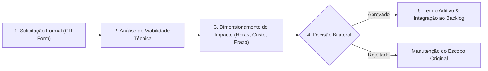

# ANEXO 4 — PROTOCOLO DE GESTÃO DE MUDANÇAS (CHANGE REQUEST - CR)

**VINCULAÇÃO CONTRATUAL:** Instrumento Técnico Vinculante integrante do Contrato de Prestação de Serviços de Engenharia de Software celebrado entre **{{CONTRATANTE_RAZAO_SOCIAL}}** ("CONTRATANTE") e **{{CONTRATADA_RAZAO_SOCIAL}}** ("CONTRATADA").

---

## 1. PRINCÍPIO DA IMUTABILIDADE DO ESCOPO SEM ADITIVO FORMAL

1. Os preços, alocação de equipe e cronograma estipulados no Contrato Principal e no **Anexo 1 (SOW)** foram calculados com base estrita nos entregáveis e arquitetura descritos.
2. Qualquer solicitação de inclusão de nova tela, alteração substancial de regra de negócio já aprovada, integração com nova API de terceiro não prevista, alteração de layout pós-aprovação ou suporte a novo caso de uso caracteriza **Mudança de Escopo (Change Request - CR)** e ensejará termo aditivo técnico-financeiro prévio.
3. **Vedação a Acordos Informais:** Nenhuma instrução verbal, mensagem em aplicativo de chat (Slack, WhatsApp, Teams) ou menção informal em reuniões terá força vinculante para alterar o escopo do projeto sem a formalização deste protocolo.

---

## 2. FLUXO DO CICLO DE VIDA DA CHANGE REQUEST

O processamento de qualquer alteração de escopo seguirá o fluxo formal em 5 (cinco) etapas:

1. **Etapa 1 — Solicitação:** O CONTRATANTE submete o Formulário de CR detalhando a justificativa de negócio e o requisito desejado.
2. **Etapa 2 — Avaliação Técnica:** A CONTRATADA analisa em até 3 (três) dias úteis o impacto na arquitetura, segurança e integridade do sistema.
3. **Etapa 3 — Proposta de Impacto:** A CONTRATADA apresenta o parecer contendo: (i) esforço em horas/dias de desenvolvimento, (ii) custo adicional de engenharia, e (iii) impacto no prazo final dos marcos subsequentes.
4. **Etapa 4 — Deliberação:** O CONTRATANTE dispõe de até 3 (três) dias úteis para aprovar ou rejeitar a proposta de CR. O silêncio implica rejeição automática da mudança sem alteração do escopo vigente.
5. **Etapa 5 — Aditivação:** Mediante assinatura bilateral, o valor e prazo adicionais são integrados ao contrato e a entrega é agendada no ciclo de desenvolvimento oportuno.

---

## 3. TABELA DE REMUNERAÇÃO DE ENGENHARIA PARA CHANGE REQUESTS

O esforço adicional decorrente de CRs aprovadas será precificado com base nas seguintes taxas horárias de referência:

| Perfil de Especialista | Custo Homem-Hora (R$/h) | Responsabilidade Típica |
| :--- | :---: | :--- |
| **Principal Architect / Tech Lead** | R$ {{TAXA_HORA_ARCHITECT}} | Redesenho arquitetural, contratos de dados, segurança |
| **Senior Software Engineer (Full Stack/Back/Front)** | R$ {{TAXA_HORA_SR_ENG}} | Implementação de lógica de negócio e integrações |
| **QA / Test Automation Specialist** | R$ {{TAXA_HORA_QA}} | Criação de suítes de teste de regressão e validação |
| **Product Designer / UI/UX** | R$ {{TAXA_HORA_DESIGN}} | Telas em alta fidelidade e fluxos de navegação |

---

## 4. FORMULÁRIO PADRONIZADO DE CHANGE REQUEST (CR FORM)

| Campo | Preenchimento Técnico |
| :--- | :--- |
| **Identificador da CR:** | CR-{{NUMERO_SEQUENCIAL}} |
| **Data de Abertura:** | {{DATA_SOLICITACAO}} |
| **Solicitante / Cargo:** | {{SOLICITANTE_NOME}} / {{SOLICITANTE_CARGO}} |
| **Título da Alteração:** | {{TITULO_SUBSTANTIVO_MUDANCA}} |
| **Módulo / Macro-Épico Afetado:** | {{MODULO_AFETADO}} |
| **Descrição Detalhada da Mudança:** | {{DESCRICAO_REQUISITO_MUDANCA}} |
| **Justificativa de Negócio:** | {{JUSTIFICATIVA_NEGOCIO}} |
| **Parecer Técnico da CONTRATADA:** | {{PARECER_TECNICO_VIABILIDADE}} |
| **Esforço Estimado (Horas):** | {{TOTAL_HORAS}} horas |
| **Valor Financeiro Adicional:** | R$ {{VALOR_TOTAL_CR}} |
| **Impacto no Cronograma Global:** | Acréscimo de {{DIAS_ACRESCIMO}} dias úteis aos Marcos {{MARCOS_AFETADOS}} |

---

## 5. REGRAS DE RECALIBRAÇÃO DE CRONOGRAMA

A aprovação de qualquer CR que demande alteração estrutural no código em produção ou dependa de novas integrações implicará a repriorização formal das sprints e o diferimento proporcional dos prazos de homologação estipulados no Anexo 1.

______________________________________
**{{CONTRATANTE_RESPONSAVEL_TECNICO}}**  
Pelo CONTRATANTE

______________________________________
**{{CONTRATADA_RESPONSAVEL_TECNICO}}**  
Pela CONTRATADA
